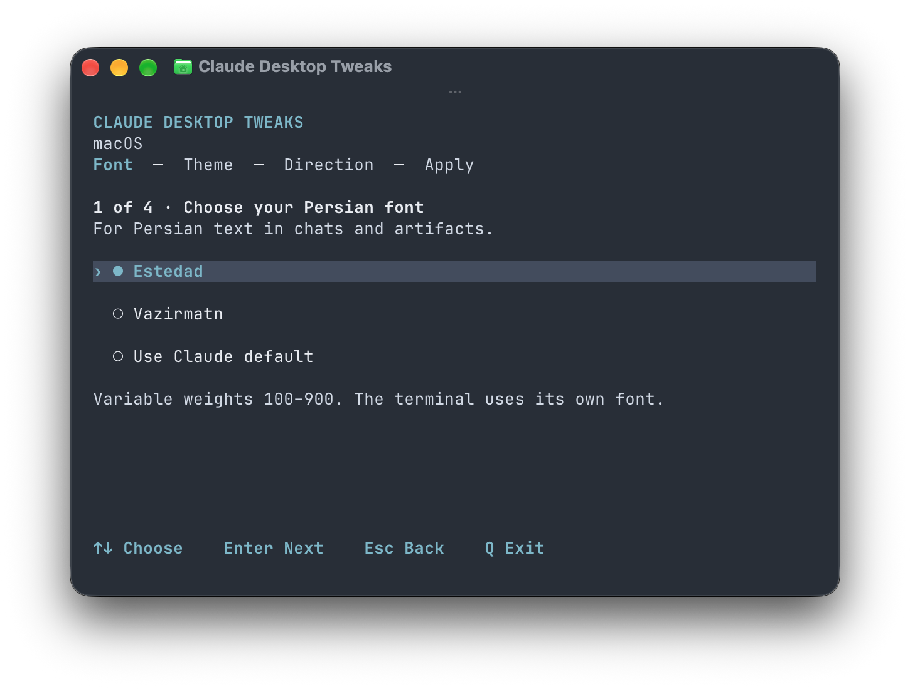

# Installer

The installer is a standalone executable with an English terminal interface and Nord colors. Use the commands in the [README](../README.md) to install it or get the latest release.

## Setup

Checks run automatically. If Claude is missing, setup shows its official source and waits for **Y** before downloading or installing it. Approve system permission prompts yourself.

New installations have four steps:

1. **Font:** Estedad, Vazirmatn, or Use Claude default.
2. **Theme:** Nord, Gruvbox Dark, or Use Claude default. A local preview follows your selection.
3. **Direction:** Automatic or Use Claude default.
4. **Apply:** review your choices, edit a row, and apply.

The terminal uses its own font. The selected Persian font applies inside Claude.

See the [settings and theme previews](../README.md#installer-preview) for the other screens.

## Versions and settings

An existing installation opens saved settings. **Installed** shows the owned extension's version. **Up to date** means it matches this installer; **Available** appears when an update is needed. Running the install command gets the latest published installer.

**Update** reviews the update with your saved choices. If you edit a choice, the review shows **Update and apply changes**. A matching version shows **Up to date**. An installer cannot replace a newer installed version with an older one. Unreadable version metadata is shown as **Unknown**; unrecognized files are preserved.

Changes require an explicit confirmation. If Claude is open, setup shows **Check again** and **Back**. Refreshing the status does not apply changes automatically.

## Controls

| Key | Action |
| --- | --- |
| Up / Down | Choose an option or row |
| Enter | Use the selected action |
| Escape | Go back |
| R | Refresh the status on settings and review screens |
| Q | Exit; confirm if choices are unsaved |

Use a terminal at least 60 columns wide and 22 rows high. Labels and values stay in fixed columns. Action hints stay at the bottom. `NO_COLOR` disables colors.

## Download feedback

Known-size downloads show a bar, percentage, received size, and average speed. Unknown-size downloads show a spinner and received size. Narrow or redirected terminals show plain phase messages.

Cancel with Ctrl+C. Partial downloads are removed. Interrupted or stalled transfers stop with retry guidance. SHA-256 verification runs before the executable is installed. HTTPS and the repository's release permissions provide download authenticity.

## Command options

| Option | Action |
| --- | --- |
| `--check` | Read-only JSON status, installed and available versions, and saved choices |
| `--version` | Installer version |
| `--help` | Help |
| `--licenses` | Bundled license notices |

To download the settings executable without opening it, add `--no-launch` to the macOS/Linux bootstrap or `-NoLaunch` to the PowerShell bootstrap. This does not apply changes to Claude.
